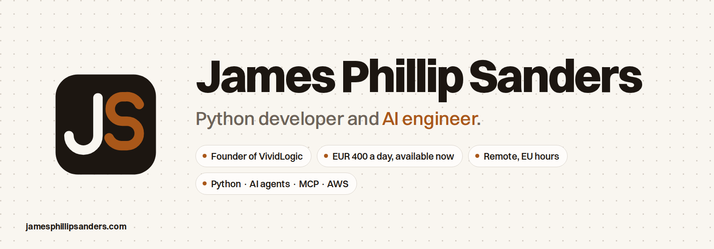

<picture>
  <source media="(prefers-color-scheme: dark)" srcset="assets/header-dark.png">
  
</picture>

I write Python services and the tooling that lets AI agents do real work safely: MCP servers, agent session control,
local LLM stacks. I specify the behaviour, let the model write much of the code, and hold the result to type checks,
tests and CI that fail loudly, then I run it on my own machines before anyone else does. I also run VividLogic, a
software company in Portugal.

**[jamesphillipsanders.com](https://jamesphillipsanders.com)** &nbsp;·&nbsp; [hello@jamesphillipsanders.com](mailto:hello@jamesphillipsanders.com) &nbsp;·&nbsp; [LinkedIn](https://www.linkedin.com/in/jmspsndrs) &nbsp;·&nbsp; [VividLogic](https://vividlogic.io)

### Open source

| | What it does | Built with |
| --- | --- | --- |
| **[kea](https://github.com/jpsanders/kea)** | A second brain that checks its facts, for you and your AI agents: sourced facts, predictions scored against what happened, a council of rival AI models for big plans, local search over your Claude Code, Codex and ChatGPT history. MCP server. | Python 3.15, no dependencies |
| **[huntaway](https://github.com/jpsanders/huntaway)** | The sheepdog for your AI agents: saves and closes idle Claude Code, Codex and OpenCode sessions, stops runaway processes before the machine freezes, hunts rootkits. MCP server. | Python 3.15 |
| **[bcp](https://github.com/jpsanders/bcp)** | Every Chromium profile its own AI agent: one Browser Control relay and MCP server per profile. | Node, no dependencies |
| **[usbuntu](https://github.com/jpsanders/usbuntu)** | A full, persistent Ubuntu on a USB stick, straight from the terminal. Refuses to touch the disk you booted from. | Python |
| **[pascal-llm-stack](https://github.com/jpsanders/pascal-llm-stack)** | Local LLMs on a 2016 GPU under the newest Ubuntu: a kernel 7.0 driver patch, CUDA 12.8, llama.cpp, 22 tokens a second. | Shell, CUDA |
| **[mothersauce](https://github.com/jpsanders/mothersauce)** | The base recipes of production Python 3.15: 26 typed, tested patterns, from dataclasses and pydantic to generics, generators and context managers, for you and your AI agent. MCP server. | Python 3.15, pydantic |
| **[lg-thermal-watch](https://github.com/jpsanders/lg-thermal-watch)** | A night watch for an LG heat pump on the official ThinQ Connect API, with an MCP server so an agent can read the room. | Python, FastAPI |
| **[banner-builder](https://github.com/jpsanders/banner-builder)** | Profile banners as SVG and PNG from a config that stays on your machine, checked for WCAG contrast. MCP server. | Python |
| **[python-package-template](https://github.com/jpsanders/python-package-template)** | Start every Python package green: Python 3.15, strict types, nine checks in CI, a man page and an agent skill. | Python |
| **[dbt-quiet-failures](https://github.com/jpsanders/dbt-quiet-failures)** | Four dbt checks for the failures that pass every other test. | dbt, SQL |

Every one ships a man page and is ready for your agent: a Claude Code plugin with a skill
(`/plugin install <name> --marketplace jpsanders/<name>`), and for huntaway, `huntaway integrate`.

### Evidence

**34 dbt models across two markets.** The staging layer of an analytics warehouse for a retail business operating in
two countries, then the dimensional models on top of it, and a Redshift loader that takes new and changed source
fields without a manual schema change. 
83 commits, Aug 2025 to Dec 2025 &nbsp;·&nbsp; 24 staging, 3 dimension, 1 fact &nbsp;·&nbsp; dbt, Redshift, Step Functions, Python, SQLFluff

**573 commits on a genotype data system.** Python services on AWS Lambda and ECS behind SQS: Illumina IDAT files land,
get linked to metadata, are checked for authorisation, loaded as genotypes, then checked for discordance against other
samples from the same animal. I built the sample QA framework and added the discordance trigger. 
20 repositories, Apr 2023 to Nov 2024 &nbsp;·&nbsp; 31% of the task dispatcher, 29% of the discordance analyser &nbsp;·&nbsp; Python, AWS Lambda, SQS, Snowflake, Terraform

Both are private client codebases. Every number comes from their commit history.

### What I do not do

No model training in production: my AI work is agents, tools and local inference, not training. No Django, Flask or
FastAPI in a client's production system. No Kubernetes cluster operations. AWS and Cloudflare, not Azure or GCP.

### Before software

**I spent seventeen years in professional kitchens.** Apprentice to head chef. Ski field hotels in New Zealand, fine
dining on the Gold Coast, Soho House in Mayfair, and seven years at a private members club in Melbourne. I retrained
while still working on the line, earning a Diploma and then a Computer Science degree with a Data Science major.

A kitchen teaches you that preparation is most of the job, that a service runs to a clock somebody else set, that the
handover to the next shift is not optional, and that nothing broken leaves the pass. Those habits transfer to
production software more directly than most of my degree did. 
Soho House, Little House Mayfair, Aug 2012 to Jun 2013 &nbsp;·&nbsp; The Melbourne Club, Aug 2015 to Dec 2022 &nbsp;·&nbsp; BCompSci, Data Science major, Swinburne, 2022
